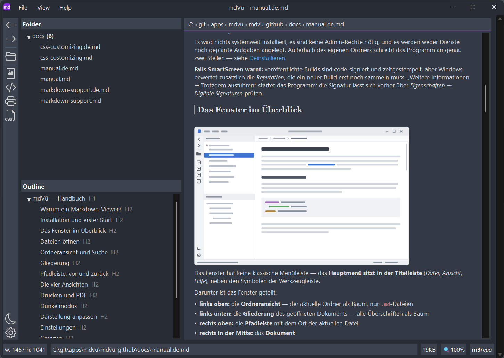

# mdVü — Handbuch

Markdown-Viewer für Windows · © 2026 Martin Niedergesäß — m3Works · *[English version](manual.md)*

---

Dies ist das ausführliche Handbuch für alle, die das ganze Bild wollen — samt Installation, Einstellungen und Fehlersuche. Eine kürzere Fassung steckt im Programm selbst: Taste `F1`.

**Inhalt**

- [Warum ein Markdown-Viewer?](#warum-ein-markdown-viewer)
- [Installation und erster Start](#installation-und-erster-start)
- [Portabel nutzen](#portabel-nutzen)
- [Das Fenster im Überblick](#das-fenster-im-überblick)
- [Dateien öffnen](#dateien-öffnen)
- [Ordneransicht und Suche](#ordneransicht-und-suche)
- [Gliederung](#gliederung)
- [Lesen mit der Tastatur](#lesen-mit-der-tastatur)
- [Favoriten](#favoriten)
- [Tags](#tags)
- [Pfadleiste, vor und zurück](#pfadleiste-vor-und-zurück)
- [Die vier Ansichten](#die-vier-ansichten)
- [Drucken und PDF](#drucken-und-pdf)
- [HTML-Datei nach Markdown wandeln](#html-datei-nach-markdown-wandeln)
- [Dunkelmodus](#dunkelmodus)
- [Frontmatter](#frontmatter)
- [Screenreader](#screenreader)
- [Darstellung anpassen](#darstellung-anpassen)
- [Einstellungen](#einstellungen)
- [Grenzen](#grenzen)
- [Tastaturkürzel](#tastaturkürzel)
- [Kommandozeile](#kommandozeile)
- [Fehlersuche](#fehlersuche)
- [Deinstallieren](#deinstallieren)

## Warum ein Markdown-Viewer?

Es gibt hervorragende Markdown-*Editoren* — Obsidian, Typora, VS Code und viele mehr. Warum also noch ein Viewer?

Weil Lesen etwas anderes ist als Schreiben. Wer schnell eine Notiz nachschlagen, eine Doku überfliegen oder eine per Mail erhaltene `.md`-Datei einfach nur *ansehen* will, braucht keinen Editor mit Plugins, Vault und Sync — sondern ein Programm, das sofort startet, die Datei anzeigt und wieder aus dem Weg ist.

mdVü ist genau dafür gebaut:

- **Schlank:** eine einzelne EXE unter 15 MB, keine Installation von Frameworks oder Laufzeitumgebungen.
- **Schnell:** native Windows-Anwendung mit eigener Render-Engine. Auch große Dokumente öffnen ohne spürbare Wartezeit.
- **Sparsam:** benötigt nur einen Bruchteil des Arbeitsspeichers Chromium-basierter Editoren, die für jedes Fenster einen kompletten Browser mitbringen.
- **Ergänzung, kein Ersatz:** mdVü will Obsidian & Co. nicht verdrängen. Es ist das Werkzeug für den schnellen Blick — Datei im Explorer doppelklicken, lesen, fertig. Der Editor bleibt fürs Schreiben zuständig.

## Installation und erster Start

Es gibt keinen Installer. mdVü ist eine einzelne ausführbare Datei:

1. `mdvu.exe` dorthin legen, wo es passt — Programmordner, USB-Stick, synchronisierter Ordner. Es läuft von überall.
2. Starten. Beim allerersten Start wird die Lizenz angezeigt und ist einmalig zu bestätigen.
3. Optional: *Datei → Als Markdown-Standard registrieren* sorgt dafür, dass `.md`-Dateien per Doppelklick in mdVü aufgehen.

Es wird nichts systemweit installiert, es sind keine Admin-Rechte nötig, und es werden weder Dienste noch geplante Aufgaben angelegt. Außerhalb des eigenen Ordners schreibt das Programm an genau zwei Stellen — siehe [Deinstallieren](#deinstallieren). Wer gar keine möchte, nimmt den [portablen Modus](#portabel-nutzen).

**Falls SmartScreen warnt:** veröffentlichte Builds sind code-signiert und zeitgestempelt, aber Windows bewertet zusätzlich die *Reputation*, die ein neuer Build erst noch sammeln muss. „Weitere Informationen → Trotzdem ausführen“ startet das Programm; die Signatur lässt sich vorher über *Eigenschaften → Digitale Signaturen* prüfen.

## Portabel nutzen

mdVü läuft auch, ohne Spuren im Benutzerprofil oder in der Registry zu hinterlassen — vom USB-Stick, aus einem synchronisierten Ordner oder aus einem Werkzeugordner, den man von Rechner zu Rechner mitnimmt. Der portable Download (`mdvu-<version>-portable.zip`) enthält `mdvu.exe` und eine leere `settings.ini`; beide in denselben Ordner entpacken.

**So funktioniert es:** liegt neben `mdvu.exe` eine Datei `settings.ini`, läuft mdVü im portablen Modus und hält alles in diesem Ordner — `settings.ini` (Werte), `user.css`, `favorites.yaml` und `tags.yaml`. Jede vorhandene EXE wird auf dieselbe Weise portabel: einfach eine leere `settings.ini` danebenlegen. Wird die Datei gelöscht (oder die EXE woandershin verschoben), nimmt mdVü wieder den normalen Einstellungsordner; beide vermischen sich nie. Einstellungen wandern nicht zwischen den Modi — `user.css`, `favorites.yaml` und `tags.yaml` bei Bedarf von Hand kopieren.

**Der Ordner muss beschreibbar sein.** Ist er es nicht (etwa unter *Programme* oder auf einem schreibgeschützten Stick), meldet mdVü das beim Start und läuft trotzdem, kann aber nichts speichern — auch nicht die Lizenz-Bestätigung, sodass sie bei jedem Start erneut abgefragt wird.

**Lizenz-Bestätigung:** im portablen Modus steht sie in der `settings.ini`, gebunden an Rechner und Windows-Benutzer. Auf einem Rechner oder Benutzerkonto, auf dem sie noch nicht bestätigt wurde, erscheint die Lizenz einmal — eine von jemand anderem kopierte `settings.ini` zählt nicht. Jeder benutzte Rechner bekommt seinen eigenen Eintrag.

**Was nicht geht:** *Datei → Als Markdown-Standard registrieren* — die Verknüpfung zeigte auf einen Ordner, der wandern oder beim nächsten Mal einen anderen Laufwerksbuchstaben haben kann. *Datei → Markdown-Registrierung entfernen* funktioniert weiterhin, zum Aufräumen nach einer früher installierten Kopie.

*Help → Diagnostics* zeigt den Einstellungsordner als *Settings (portable)*.

## Das Fenster im Überblick



Das Fenster hat keine klassische Menüleiste — das **Hauptmenü sitzt in der Titelleiste** (*Datei*, *Ansicht*, *Hilfe*), neben den Symbolen der Werkzeugleiste.

Darunter ist das Fenster geteilt:

- **links oben:** die **Ordneransicht** — der aktuelle Ordner als Baum, nur `.md`-Dateien
- **links unten:** die **Gliederung** des geöffneten Dokuments — alle Überschriften als Baum
- **rechts oben:** die **Pfadleiste** mit dem Ort der aktuellen Datei
- **rechts in der Mitte:** das **Dokument**
- **unten:** die Statuszeile mit Angaben zum Dokument und Hinweisen, dazu, wo die Datei liegt (Obsidian-Vault, Git-Repository)

`F6` schaltet den Tastaturfokus reihum zwischen den Bereichen weiter.

## Dateien öffnen

Es gibt mehrere Wege, eine Datei zu öffnen:

- **Drag & Drop:** eine `.md`-Datei oder einen ganzen **Ordner** auf das Fenster ziehen. Ein Ordner wird in der Ordneransicht geöffnet und zeigt seine Ordnerseite. Wird mehreres zugleich fallengelassen, hat eine Datei Vorrang vor einem Ordner.
- **Schnell öffnen** mit `Strg+O`: wie bei der Suche erscheint unter der Pfadleiste eine Leiste. Tippen Sie einen Teil eines Dateinamens, eines Alias (`aliases` im Frontmatter, wie in Obsidian) oder eines Ordnernamens — die Treffer erscheinen darunter in einer Liste, die besten zuerst; Ordner tragen ein 📁, rechts steht jeweils der Ordner des Treffers. Wählen Sie einen Ordner, **betreten** Sie ihn direkt in der Liste: eine Kopfzeile zeigt, wo Sie sind, darunter stehen seine Unterordner und Dateien; Tippen sucht jetzt nur in diesem Ordner (auch tiefer), `Backspace` im leeren Feld geht eine Ebene hoch. Mit der Einstellung `quickOpen/folder = open` öffnet ein Ordner stattdessen als Ordnerseite, gleich bereit für die Tastatur (Pfeiltasten von Link zu Link). Ordner zählen, wenn darin (auch tiefer) Markdown-Dateien liegen. `↓` wechselt in die Liste, `↑`/`↓` wählen, `Enter` öffnet (im Eingabefeld: den ersten Treffer); `Esc` in der Liste springt zurück ins Eingabefeld, ein zweites `Esc` schließt. Mehrere Wörter müssen alle passen, in beliebiger Reihenfolge; passt nichts zum Namen, prüft mdVü auch die Ordnernamen und zuletzt die Buchstaben der Reihe nach (`mdrd` findet `mdvu-readme`). Gesucht wird im ganzen Vault bzw. Repository des aktuellen Dokuments, sonst im Ordner der Ordneransicht. Haben Sie Favoriten, wechselt ein zweites `Strg+O` (oder der Knopf rechts in der Leiste) auf **alle Favoriten** — und ein weiteres wieder zurück. Bei leerem Feld zeigt die Liste die zuletzt geöffneten Dateien.
- **Öffnen-Dialog** mit `Strg+Umschalt+O`.
- **Startseite** (*Datei → Start page*): die zuletzt geöffneten Dateien und Ihre Favoriten, je einen Klick entfernt. Sobald Sie einmal eine Datei geöffnet haben, startet mdVü mit dieser Seite; die Willkommensseite des Erststarts steht im Menü *Hilfe*.
- **Ordneransicht:** Ein Klick auf eine Datei im Ordnerbaum links oder das Durchblättern mit den Pfeiltasten zeigt sie sofort an — aber nur zum **Hineinschauen** (Peek): Sie landet weder im Verlauf (*Zurück*) noch in den zuletzt benutzten Dateien, und die Pfadleiste zeigt ihren Namen *kursiv*. `Enter` oder ein Doppelklick öffnet die Datei richtig und setzt den Fokus ins Dokument; ein Klick ins Dokument oder `F6` macht dasselbe mit einer angesehenen Datei. `Strg+Umschalt+E` führt zurück in die Ordneransicht. Ein **Ordner** erscheint als eigene Seite: seine Unterordner und Markdown-Dateien mit Größe, Datum und den ersten Zeilen jeder Datei. `Enter` (oder ein Klick in die Seite) wechselt hinein, bereit für die Tastatur — die Pfeiltasten gehen von Link zu Link, `Enter` öffnet eine Datei oder einen Unterordner. Öffnen Sie eine Datei oder einen Ordner, die zu einem Obsidian-Vault oder Git-Repository gehören — per Kommandozeile, Dateidialog, Drag & Drop, Link, Pfadleiste oder aus den zuletzt benutzten Dateien —, zeigt die Ordneransicht den **ganzen Vault bzw. das ganze Repository** und markiert darin die Datei oder den Ordner; bei Verschachtelung den inneren Vault bzw. das innere Repository. Solange Sie sich darin bewegen, bleibt die Ordneransicht stehen. Dateien und Ordner, deren Name mit einem Punkt beginnt (`.git`, `.obsidian` …), werden nicht angezeigt (Einstellung `ui/folderTreeHideDot`).
- **Zuletzt verwendet:** Das *Datei*-Menü führt die zuletzt geöffneten Dateien und Ordner. Auch die **Startseite** (*Datei → Startseite*) zeigt die letzten fünf Dateien.
- **Doppelklick im Explorer:** Über *Datei → Als Markdown-Standard registrieren* verknüpft sich mdVü mit `.md`-Dateien (pro Benutzer, keine Admin-Rechte nötig). Windows fragt ggf. einmalig per „Öffnen mit“ nach — siehe [Fehlersuche](#fehlersuche).
- **Kontextmenü im Explorer:** Dieselbe Registrierung ergänzt bei jeder `.md`-Datei — auch wenn ein anderes Programm Standard ist — *Open with mdVü*, *Print with mdVü* (öffnet die Druckvorschau) und *Export as PDF with mdVü*, bei Ordnern *Open in mdVü*. Unter Windows 11 stehen sie unter *Weitere Optionen anzeigen* (`Umschalt+F10`). Wer mit einer früheren Version registriert hat, registriert einmal neu, um sie zu bekommen.
- **Kommandozeile:** `mdvu.exe "C:\Notizen\Liesmich.md"` — siehe [Kommandozeile](#kommandozeile).
- **Mehrere Fenster:** *File → New window* (`Strg+N`) öffnet das aktuelle Dokument in einem zweiten Fenster; *Open in new window* im Menü einer Datei oder eines Ordners (Rechtsklick in der Ordneransicht oder auf den Pfad in der Statuszeile) tut dasselbe für diese Datei bzw. diesen Ordner, ebenso `Strg`+Klick auf einen Link oder die mittlere Maustaste auf einen Link oder in der Ordneransicht. Jedes Fenster hat seine eigene Ordneransicht, seinen Verlauf und seine Suche; zuletzt geöffnete Dateien und Favoriten teilen sie sich. Das Programm endet mit dem letzten Fenster.
- **mdVü läuft schon:** eine aus dem Explorer oder per Kommandozeile geöffnete Datei bleibt im laufenden Programm. Liegt sie in einem Vault oder Repository, das in einem der Fenster offen ist, oder im Ordner einer Ordneransicht, öffnet sie dort, und das Fenster kommt nach vorn. Eine Datei außerhalb jedes Vaults oder Repositorys landet in dem Fenster, das schon eine solche Datei zeigt — lose Dateien türmen also keine Fenster auf. Alles andere öffnet ein neues Fenster. *Print with* und *Export as PDF with* laufen immer für sich. Ist in mdVü ein Dialog offen, öffnet die Datei stattdessen in einem eigenen mdVü.

Wird die angezeigte Datei von einem anderen Programm geändert, lädt mdVü sie automatisch neu — die Scrollposition bleibt erhalten. Mit `F5` geht das auch von Hand. Dateien, die im aktuellen Ordner hinzukommen oder verschwinden, erscheinen im Baum ohne manuelles Auffrischen; das gilt rekursiv, also auch für Unterordner.

Sehr große Dateien werden bis zu einer Grenze von **50 MB** geladen — ein Banner am Dokumentanfang weist darauf hin, dass nur der Anfang angezeigt wird. Siehe [Grenzen](#grenzen).

## Ordneransicht und Suche

Die Ordneransicht zeigt den Ordner des aktuellen Dokuments, gefiltert auf `*.md`. Sie ist kein Vault und kein Workspace: es ist schlicht der Ordner, in dem man gerade ist, und sie folgt der Navigation. In einem Obsidian-Vault oder Git-Repository zeigt der Baum alle Unterordner, sonst zwei Ebenen tief — damit etwa `C:\` nicht das ganze Laufwerk durchsucht.

**Zuletzt geändert.** Ein farbiger Punkt hinter einer Datei zeigt, wie lange die letzte Änderung her ist — rot bis 10 Minuten, orange bis eine Stunde, gelb bis ein Tag, grau bis eine Woche. Ein Ordner zeigt den Punkt der zuletzt geänderten Datei darin, auch wenn er zugeklappt ist. Die Punkte gehen mit, solange mdVü offen ist, auch bei Änderungen durch andere Programme, und eine eben geänderte oder neue Datei leuchtet kurz auf. Die Uhr ⏱ im Kopf der Ordneransicht filtert den Baum: nur Dateien zeigen, die in den letzten 10 oder 30 Minuten, der letzten Stunde, dem letzten Tag oder der letzten Woche geändert wurden. Der Filter bleibt beim Suchen in der Ordneransicht und beim Wechsel in einen anderen Ordner eingeschaltet; beim nächsten Start ist er wieder aus.

`Strg+F` öffnet den Suchstreifen für das Haupt-Pane — also für die gerade sichtbare Ansicht: Dokument, Quelltext, CSS oder Druckvorschau. `F3` und `Umschalt+F3` springen zum nächsten bzw. vorherigen Treffer im Haupt-Pane, egal wo der Fokus gerade steht: im Suchfeld, im Dokument, auch in Ordneransicht oder Gliederung. Man kann also weiterlesen und mit `F3` weiterspringen.

`Strg+F3` sucht dort, wo Sie gerade sind — der Bereich mit dem Tastaturfokus bekommt den Streifen. Nur so erreicht man Ordneransicht und Gliederung, und anders als `Strg+F` schaltet diese Taste den Streifen auch wieder aus.

In der **Ordneransicht** und in der **Gliederung** erscheint der Streifen über dem Baum. Während der Eingabe wird der Baum gefiltert — auf passende Dateien bzw. Überschriften —, Treffer werden hervorgehoben. Die Pfeil-runter-Taste setzt den Fokus vom Suchfeld in den Baum — tippen, dann blättern, ganz ohne Maus. Nach dem Schließen ist der Baum wieder so aufgeklappt wie vor der Suche.

Im **Dokument, im Quelltext, im CSS-Editor und in der Druckvorschau** erscheint der Streifen unter der Pfadleiste und arbeitet wie die Suchleiste eines Browsers: `Eingabe` und `Umschalt+Eingabe` gehen durch die Treffer (im Dokument und in der Druckvorschau führt ein weiteres `Eingabe` stattdessen in den Text — s. *Lesen mit der Tastatur*), ein Zähler zeigt *Treffer / gesamt*, und alle Treffer sind gleichzeitig hervorgehoben. Drei Umschalter verfeinern die Suche:

| Umschalter | Bedeutung |
|---|---|
| `Aa` | Groß-/Kleinschreibung beachten (standardmäßig aus) |
| `.*` | Suchtext als regulären Ausdruck lesen |
| `Sel` | Suche auf die aktuelle Auswahl beschränken (nur im Dokument; braucht eine nicht-leere Auswahl) |

Im **Dokument** durchsucht mdVü immer den ganzen Text — auch Teile sehr großer Dateien, die noch gar nicht angezeigt wurden; gefunden wird, was man sieht (`foo` trifft auch `**fo**o`, aber nicht eine Link-Adresse). Beim Tippen sucht mdVü erst, wenn Sie kurz innehalten (0,3 Sekunden), und erst ab **3 Zeichen** — so bleibt die Eingabe auch in großen Dokumenten flüssig. `Eingabe` und `F3` suchen sofort, auch kürzere Begriffe. Steht der Begriff in Anführungszeichen (`"ab"`), wird genau dieser Text gesucht, auch wenn er kurz ist oder am Rand Leerzeichen hat. Bei sehr vielen Treffern werden die ersten 10 000 markiert; die Statuszeile sagt Bescheid.

Nochmal `Strg+F3` oder der `X`-Knopf schließt den Streifen — Hervorhebungen verschwinden, der Ordnerfilter wird aufgehoben. Die Suche ist ein Modus: `Esc` im Dokument, in der Ordneransicht oder auf einem Knopf des Streifens führt zuerst zurück ins Suchfeld; `Esc` im Feld schließt den Streifen. Der Suchbegriff selbst bleibt erhalten: `Strg+F` holt ihn wieder ins Feld, `F3` nimmt die Suche beim ersten Treffer wieder auf. Damit kann `F3` auch ohne sichtbaren Streifen Hervorhebungen im Dokument stehen lassen; `Esc` im Dokument räumt sie weg.

Solange eine Dokumentsuche läuft — der Streifen ist offen, oder `F3` hat Hervorhebungen stehen lassen —, **wandert sie beim Öffnen eines anderen Dokuments mit**: Der Begriff wird dort sofort gesucht, die Treffer werden hervorgehoben. Die Ansicht springt dabei nicht zum ersten Treffer; `Eingabe` oder `F3` führt dorthin. Eine geschlossene Suche bleibt geschlossen.

Es ist immer höchstens ein Streifen offen; ein Ansichtswechsel schließt den Streifen des Haupt-Panes (die Streifen über den Bäumen bleiben).

In der Druckvorschau setzt `↓` oder ein weiteres `Eingabe` den Fokus auf die Seiten: Die Pfeiltasten gehen dann durch die Treffer, die Statuszeile zeigt `HIT 2/7`, `Bild↑`/`Bild↓` und das Mausrad blättern weiter. `Esc` führt zurück ins Suchfeld.

Hinweis zur Druckvorschau: Sie durchsucht, was tatsächlich paginiert wurde. Dokumente, die an der 200-Seiten-Grenze abgeschnitten sind, enden auch für die Suche dort.

## Suchen in Dateien

`Strg+Umschalt+F` öffnet einen Streifen, der **alle Markdown-Dateien** eines Bereichs auf einmal durchsucht. Es gibt zwei Bereiche; der Knopf neben dem Suchfeld zeigt den aktuellen:

| Bereich | Was er umfasst |
|---|---|
| Ort des Dokuments | den Obsidian-Vault des aktuellen Dokuments, sonst sein Git-Repository, sonst den Ordner der Ordneransicht (samt Unterordnern) |
| Alle Favoriten | alle Ordner unter Ihren Favoriten auf einmal; die Treffer nach Favorit gruppiert |

Der Streifen beginnt immer beim Ort des Dokuments. Haben Sie Favoriten, wechselt ein zweites `Strg+Umschalt+F` bei Cursor im Suchfeld (oder ein Klick auf den Bereichs-Knopf) auf alle Favoriten — und ein weiteres wieder zurück. Andere Orte, etwa alle Orte mit einem Ihrer eigenen [Tags](#tags), kommen mit `scope:` in den Suchtext (s. Suchsyntax). Markierter Text oder der Begriff einer laufenden Dokumentsuche wird übernommen. `Enter` startet die Suche; zeigt das Dokument schon die Trefferliste genau dieser Suche, setzt `Enter` stattdessen den Fokus in die Liste (`F5` sucht neu). `↓` landet immer in der Liste — sind Begriff oder Schalter seither geändert, wird vorher gesucht, man landet also nie in alten Ergebnissen. `Aa` beachtet Groß-/Kleinschreibung; ein Begriff in Anführungszeichen (`"ab"`) sucht genau diesen Text. Zwei weitere Umschalter legen Wortgrenzen fest — es ist immer höchstens einer an:

| Umschalter | Bedeutung |
|---|---|
| `ab…` | Wortanfang, auch nach Bindestrich oder Satzzeichen: `der` findet *derzeit* und *Nord-der*, aber nicht *oder* |
| `\|ab\|` | nur ganze Wörter |
| `.*` | Begriff als regulären Ausdruck lesen; die Wortgrenzen-Umschalter gelten dann nicht (im Muster `\b` verwenden). Die Links der Trefferliste nehmen das mit |

Suchen beim Tippen gibt es hier nicht: eine Suche über Tausende Dateien beginnt erst, wenn Sie sie anstoßen.

Das Ergebnis ist ein **eigenes Dokument** mit eigenem Platz im Verlauf:

- zuerst die Dateien, deren **Name** passt, auch ohne Treffer im Text;
- dann die Treffer nach Ordnern gruppiert — jede Datei mit der Zahl ihrer Treffer und bis zu drei Zeilen Kontext, der Treffer hervorgehoben;
- ein Klick auf den Dateinamen öffnet die Datei am ersten Treffer, ein Klick auf eine Zeilennummer genau an diesem Treffer. Die Dokumentsuche ist dort schon belegt, `F3` geht also in der Datei weiter. Die Liste öffnet bereit für die Tastatur: Pfeiltasten oder `Tab` gehen von Treffer-Link zu Treffer-Link, `Eingabe` öffnet ihn (s. *Lesen mit der Tastatur*).

**Zurück** (`Alt+←`) führt zur Trefferliste an die Stelle, von der Sie kamen. Die Liste wird aufbewahrt — die letzten fünf Trefferlisten hält mdVü im Speicher —, sie sieht also genauso aus wie vorher, auch wenn sich Dateien inzwischen geändert haben. `F5` auf der Trefferliste sucht neu. Weil die Liste ein Dokument ist, können Sie darin suchen (`Strg+F`), sie drucken oder als PDF speichern, und ihre Gliederung zeigt die Ordner und Dateien.

Große Ordner werden im Hintergrund durchsucht: die Liste wächst, während Sie lesen, die Fußzeile zeigt den Fortschritt. Wer ein anderes Dokument öffnet, bricht eine laufende Suche ab; zurück auf der Liste wird dann neu gesucht. Dateien über der Ladegrenze (`doc/maxLoadMB`) werden wie in der Anzeige bis zu dieser Grenze durchsucht; die Liste kennzeichnet sie.

mdVü durchsucht **den Text, den Sie sehen** — in Dateien genau wie im Dokument, beide zählen also dieselben Treffer: Frontmatter (Eigenschaften) gehört dazu und ist in der Liste gekennzeichnet, `%%Kommentare%%`, Linkziele und Markdown-Auszeichnung dagegen nicht. Die Suche in Obsidian findet Kommentare. Versteckte Ordner (mit Punkt am Anfang, etwa `.obsidian` oder `.git`) werden übersprungen, durchsucht werden nur `*.md`-Dateien.

### Suchsyntax

Mehrere Wörter finden Dateien, die **alle** enthalten, in beliebiger Reihenfolge. Die Schreibweise folgt Obsidian und GitHub:

| Eingabe | Findet |
|---|---|
| `rechnung mahnung` | Dateien mit beiden Wörtern (im Dateinamen oder im Text) |
| `rechnung OR mahnung` | Dateien mit einem davon (`OR` großgeschrieben) |
| `rechnung -entwurf` | *rechnung*, aber nicht *entwurf* (auch `NOT entwurf`) |
| `(a OR b) c` | Klammern gruppieren |
| `"offene Posten"` | genau diesen Text |
| `/rech(nung)?/` | einen regulären Ausdruck |
| `#todo` | Dateien mit dem Tag *todo* — eigener oder im Dokument, auch `#todo/untertag` |
| `tag.own:todo` | nur eigene Tags; `tag.fm:` nur das Frontmatter, `tag.-fm:` alles außer dem Frontmatter |
| `tag:todo,idee` | einen der Tags (Komma = oder); `tag:=todo` ohne Untertags |
| `file:readme`, `path:2026` | Dateiname bzw. Pfad enthält es (`file:=readme.md`: genau) |
| `content:rechnung` | nur im Text, nicht im Dateinamen |
| `line:(rechnung offen)` | beide Wörter in derselben Zeile; `section:( … )` im selben Abschnitt (von einer Überschrift bis zur nächsten) |
| `modified:>=-7d` | in den letzten sieben Tagen geändert; auch `modified:2026-10` (im Oktober), `modified:<2026`, `modified:2026-01..2026-03`, `created:` |
| `size:>1mb` | größer als 1 MB; `size:10kb..1mb` für einen Bereich |
| `[status]` | das Frontmatter hat die Eigenschaft *status* |
| `[status:entwurf,review]` | die Eigenschaft enthält einen der Werte; `[prio>=2]`, `[status!=fertig]` vergleichen |
| `[kunde.name:müller]` | eine verschachtelte Eigenschaft; durch eine Liste heißt es „irgendein Eintrag“, z.B. `[aliases:x]` |
| `scope:favorites` | woanders suchen: `vault`, `repo`, `folder` (zum Bereich, der im Streifen gewählt ist), `favorites`, `#tag`; mit Komma mehrere |

Ohne Suchwort (nur `#todo`, `file:` …) ist das Ergebnis eine einfache Liste der passenden Dateien. Außer Buchstaben, Ziffern und `_` — sowie `-` oder `/` innerhalb eines Worts — sind Zeichen reserviert: einen Begriff wie `C#`, `a&b` oder `datei.md` setzen Sie in Anführungszeichen. Ein Fehler in der Suche erscheint in der Statuszeile.

Datumsangaben schreiben Sie als `2026-10-19`, `2026-10` (ein Monat), `2026-Q4`, `2026-W42` oder relativ zu heute: `today`, `yesterday`, `-7d`, `-2w`, `-3m`, `-1y` (jeweils ein ganzer Tag). Im Vergleich mit einem Zeitraum heißt `=` oder `:` darin, `<` davor und `>` danach. Größen nehmen `b`, `kb`, `mb`, `gb`. In `[ … ]` darf auch gerechnet werden (`[preis * menge > 1000]`); `-` ist dort immer ein Minus, ein Eigenschaftsname mit Bindestrich steht deshalb in Anführungszeichen: `["fällig-am"<today]`. Ein einzelnes Wort rechts ist Text (`[status=entwurf]`); `=` vergleicht genau, `:` ohne Groß-/Kleinschreibung und findet auch Teile.

`created:` ist das Erstelldatum des Dateisystems — Kopieren oder Auschecken setzt es neu; eine Eigenschaft `created` im Frontmatter ist verlässlicher (`[created<2026]`).

## Gliederung

Unterhalb der Ordneransicht zeigt mdVü die **Gliederung** des aktuellen Dokuments — alle Überschriften als Baum, nach Ebenen verschachtelt. Ein Klick springt zur entsprechenden Stelle im Dokument; das Sprungziel leuchtet kurz auf, damit das Auge es sofort findet. Wie in der Ordneransicht schauen Klick und Pfeiltasten nur hinein; erst `Enter` oder ein Doppelklick nimmt den Sprung in den Verlauf auf, *Zurück* führt dann wieder zu diesem Kapitel.

Bei einem langen Dokument ist die Gliederung der schnellste Weg: kein Scrollen, kein Suchen, ein Klick. Bei sehr vielen Überschriften hilft `Strg+F3` mit dem Fokus in der Gliederung: Der Streifen filtert sie auf die Überschriften, die den Suchtext enthalten — samt der übergeordneten, damit man sieht, wo sie stehen.

## Lesen mit der Tastatur

mdVü ist ein Leser, das Dokument braucht also nicht ständig einen Textcursor — die Tasten sind frei, um sich in **Einheiten** durchs Dokument zu bewegen, ähnlich wie man im Browser per Tab durch die Links geht. Der Footer zeigt immer die aktive Einheit:

| Taste | Einheit | Footer | Pfeiltasten |
|---|---|---|---|
| `0` | Scrollen | `SCROLL` | scrollen wie im Browser, ebenso `Bild↑`/`Bild↓` und `Pos1`/`Ende` (Grundeinstellung) |
| `1` | Caret | `CARET` | bewegen einen Textcursor zeichen- und zeilenweise, wie nach einem Klick in den Text |
| `L` | Links | `LINK 3/41` | `←`/`→` voriger/nächster Link in Lesereihenfolge, `↑`/`↓` nächstgelegener Link in der Zeile darüber/darunter |
| `H` | Treffer | `HIT 2/17` | gehen durch die Treffer der Dokumentsuche (`Strg+F`) |

Ein Klick auf die Einheit im Footer öffnet ein Menü mit allen Einheiten.

`F7` schaltet zwischen Scrollen und Caret um (wie *Caret Browsing* im Browser). `Tab` und `Umschalt+Tab` gehen immer zum nächsten/vorigen Link, egal welche Einheit gilt, und `Eingabe` folgt dem aktiven Link — bzw. dem Link am Caret. Der erste Link ist der erste **im Bild**, nicht der erste im Dokument; der aktive Link ist hervorgehoben (CSS: `highlight.nav`). `↑`/`↓` bewegen sich wirklich senkrecht: Sie überspringen die übrigen Links derselben Zeile und gehen zum nächstgelegenen Link in der nächsten Zeile darüber bzw. darunter, die einen hat.

Der Weg aus der Suche: In der Suchleiste des Dokuments sucht das erste `Eingabe`, jedes weitere `Eingabe` — und `↓` jederzeit — setzt den Fokus ins Dokument mit der Einheit *Treffer*, `←`/`→` gehen dann durch die Treffer weiter. Die Trefferliste von *Suchen in Dateien* öffnet mit der Einheit *Links*: sobald Sie hineinwechseln, ist der erste Link im Bild hervorgehoben, `Eingabe` öffnet ihn. Die Markierung bleibt an ihrem Ziel, auch wenn eine große Suche noch Ergebnisse nachliefert.

Ein Klick in den Text schaltet auf den Caret. `Esc` geht den Weg zurück, den Sie gekommen sind: von Links oder Treffern ins Feld des offenen Suchstreifens (Dokumentsuche oder Suchen in Dateien) — ein zweites `Esc` dort schließt ihn und führt zurück ins Dokument beim Scrollen —, ohne Streifen direkt zum Scrollen. Die Einheit gehört zum Ort im Verlauf: **Zurück** bringt sie wieder, samt aktivem Link. Wer in der Einheit *Links* einem Link folgt, bleibt darin — das nächste Dokument beginnt beim ersten Link im Bild. Ein Link, der eine Suche mitbringt (wie die Treffer von *Suchen in Dateien*), öffnet stattdessen mit dieser Suche. Die Tasten `2` bis `5` sind für Wörter, Sätze, Absätze und Überschriften reserviert. Links funktionieren auch in sehr großen Dokumenten, auch in Teilen, die noch nicht angezeigt wurden.

## Favoriten

Ordner, zu denen Sie oft zurückkehren — Ihre Vaults, Ihre Repositories —, lassen sich als **Favoriten** merken. `Strg+D` nimmt den Ordner der Ordneransicht auf oder entfernt ihn wieder; der **Stern** in der Leiste ist gefüllt, wenn der aktuelle Ordner ein Favorit ist. Ein Klick auf den Stern (oder `Strg+Umschalt+D`) öffnet die Liste: Pfeiltasten und `Enter` öffnen einen Favoriten, `Entf` entfernt den markierten. Die Favoriten stehen auch im Menü **File**, und das Menü zu einer Datei oder einem Ordner (Rechtsklick in der Ordneransicht) nimmt sie auf oder entfernt sie. Die Suche in Dateien kann **alle Favoriten** auf einmal durchsuchen. mdVü speichert sie in `favorites.yaml` bei den übrigen Einstellungen.

## Tags

Dateien und Ordner lassen sich mit **eigenen Tags** versehen — ohne dass sich eine Datei ändert: mdVü legt sie im Einstellungsordner ab, ein Git-Repository oder ein fremder Vault bleibt also unberührt. Rechtsklick auf eine Datei oder einen Ordner (in der Ordneransicht, auf den Pfad in der Statuszeile oder irgendwo im geöffneten Dokument), dann **Tags…**: die Liste zeigt alle Ihre Tags mit Häkchen; ein Klick setzt oder entfernt einen, und die Liste bleibt offen, sodass sich mehrere setzen lassen. **New tag…** fragt nach einem Namen — Buchstaben, Ziffern, `_`, `-` und `/`, mindestens ein Zeichen keine Ziffer; `projekt/mdvu` zählt auch als `projekt`. Ein Tag an einem **Ordner** gilt für alles darunter; solche geerbten Tags stehen ausgegraut mit dem Ordner, von dem sie kommen. Die Seite eines Ordners zeigt seine Tags oben.

In der Suche in Dateien durchsucht `scope:#tag` alle Orte mit diesem Tag auf einmal — praktisch für Ordner, die über mehrere Vaults verstreut sind, etwa alle `Protokoll`-Ordner mit `#tagesprotokoll`. *File → Show tags* listet alle Tags mit ihren Orten. Wird ein Ort umbenannt oder verschoben, während mdVü läuft, ziehen seine Tags mit; Orte, die sich nicht mehr finden, stehen dort gesondert — mit Links, um die Tags dem neuen Ort zuzuordnen oder sie zu entfernen.

Tags, die im **Frontmatter** eines Dokuments stehen (`tags:` oder `tag:`, als Liste oder mit Kommas getrennt), zählen ebenso — eigene Tags und Dokument-Tags sind ein gemeinsamer Satz. Oben im Dokument zeigt eine Zeile alle seine Tags: Dokument-Tags gefüllt, eigene nur umrandet; ein Klick listet alle Dateien mit diesem Tag im selben Vault, Repository oder Ordner. Bei vielen Tags zeigt `+n` am Ende den Rest. Die Statuszeile zeigt die Anzahl (`#3`); ein Klick öffnet die Liste samt Herkunft jedes Tags. Im Suchfeld der *Suche in Dateien* listet `#name` alle Dateien mit diesem Tag und beschränkt jede Suche auf sie; `tag.own:name` zählt nur eigene Tags, `tag.fm:name` nur das Frontmatter (siehe [Suchsyntax](#suchsyntax)). Die eigenen Tags speichert mdVü in `tags.yaml` bei den übrigen Einstellungen.

## Pfadleiste, vor und zurück

Über dem Dokument zeigt die **Pfadleiste** den Ort der aktuellen Datei. Jedes Segment ist klickbar: Ein Klick auf einen Ordner öffnet ihn in der Ordneransicht und zeigt seine Ordnerseite.

**Das Menü zur Datei.** Ein Klick auf den Dateipfad in der Statuszeile öffnet ein Menü zu dieser Datei: Pfad kopieren, im Explorer zeigen, in Obsidian öffnen (innerhalb eines Vaults) oder mit einem anderen Programm, das für `.md`-Dateien installiert ist. Dasselbe Menü öffnet ein Rechtsklick auf eine Datei oder einen Ordner in der Ordneransicht oder auf die **Obs**/**Git**-Plakette in der Statuszeile — in der Ordneransicht auch per Tastatur mit `Umschalt+F10` oder der Kontextmenü-Taste.

Wie im Browser navigiert mdVü durch die Historie: Pfeil-Symbole in der Leiste oder `Alt+←` / `Alt+→`. Ein **Rechtsklick auf die Pfeile** öffnet die Verlaufsliste — damit lässt sich ein früheres Dokument direkt anspringen, statt sich Schritt für Schritt zurückzuklicken.

**Zurück führt an die Stelle, an der Sie waren** — nicht an den Dokumentanfang. mdVü merkt sich dafür die oberste sichtbare Zeile im Text, nicht eine Pixelposition; das passt auch dann noch, wenn sich Fensterbreite oder Zoom inzwischen geändert haben oder das Dokument erst stückweise nachgeladen wird. Ist die Datei inzwischen kürzer geworden, landet man am Ende. Eine laufende Suche im Dokument kommt mit zurück: Suchbegriff, Optionen, aktiver Treffer und Streifen. Wer die Suche vor dem Weitergehen mit `Esc` geschlossen hat, findet sie beim Zurückblättern auch nicht wieder.

Links innerhalb von Dokumenten funktionieren wie erwartet: ein relativer Link auf eine andere `.md`-Datei öffnet diese Datei, ein Link auf eine Überschrift (`#abschnitt`) springt im Dokument, ein `http(s)`-Link geht nach Rückfrage in den Browser. Links, die ins Leere oder ins Zwielichtige führen, werden abgelehnt statt befolgt. Ein Link der Form `mdvu:open?uri=…&find=…` bzw. `&mark=…` öffnet ein Dokument und markiert dabei Fundstellen oder Zeilen — siehe [Fundstellen verlinken](markdown-support.de.md#fundstellen-verlinken).

**Sprünge innerhalb eines Dokuments gehören zum Verlauf.** Wer einem Link auf eine Überschrift im selben Dokument folgt, bekommt einen Eintrag; *Zurück* führt an die Stelle des Links – und der Link, von dem man kam, ist einen Moment lang markiert, damit das Auge ihn wiederfindet. Dasselbe geschieht bei der Rückkehr aus einem anderen Dokument. Die Verlaufsliste (Rechtsklick auf die Pfeile) zeigt bei einem solchen Eintrag die Überschrift hinter dem Dateinamen.

**Wohin ein Link führt.** Links, die mdVü verlassen – Webadressen und E-Mail-Links –, haben eine eigene Farbe; so erkennt man sie vor dem Klick neben den Links innerhalb der eigenen Dokumente. Die Rückfrage vor dem Öffnen des Browsers bleibt. Solange die Maus auf einem Link steht, zeigt die Statuszeile sein Ziel statt des Dateinamens; in der Link-Einheit (`L`) das Ziel des aktiven Links. Die Farbe lässt sich im eigenen [CSS](css-customizing.de.md) über `a.external` ändern.

## Die vier Ansichten

Der Dokumentbereich beherbergt vier austauschbare Ansichten:

| Ansicht | Kürzel | Wofür |
|---|---|---|
| **Markdown** | `Strg+1` | das gerenderte Dokument — die normale Ansicht |
| **Quelltext** | `Strg+2` | der rohe Markdown-Text, syntaxgefärbt, nur lesend |
| **CSS** | `Strg+4` | das eigene Stylesheet, siehe [Darstellung anpassen](#darstellung-anpassen) |
| **Druckvorschau** | `Strg+F2` oder `Strg+3` | das umbrochene Dokument, so wie es druckt |

Beim Zurückschalten von der CSS-Ansicht auf die Markdown-Ansicht wird das geänderte Stylesheet sofort angewandt.

## Drucken und PDF

mdVü bringt eine eigene Druck- und PDF-Ausgabe mit — kein Umweg über den Browser oder einen PDF-Druckertreiber:

- **Druckvorschau** (`Strg+F2`): auch bei umfangreichen Dokumenten stehen 100 Seiten in wenigen Sekunden bereit.
- **Seiteneinrichtung:** Eine Leiste oben in der Druckvorschau wählt Drucker, Papierformat (A3, A4, A5, A6, Letter, Legal) und Hoch- oder Querformat. Die Vorschau wird sofort neu umbrochen, Druck und PDF verwenden genau dieses Format — was die Vorschau zeigt, kommt aus dem Drucker. *Printer setup…* öffnet die Windows-Druckereinstellungen, ohne zu drucken; dort gewählter Drucker, Papierformat und Ausrichtung werden übernommen. Die Leiste gehört fest zur Vorschau: `Strg+Umschalt+P` öffnet die Vorschau mit dem Fokus in der Leiste, ihr **×** oder `Esc` schließt die ganze Vorschau und kehrt zur normalen Ansicht zurück. Die Auswahl bleibt gespeichert. In einem schmalen Fenster wird zuerst die Druckerliste schmaler; danach wandern *Printer setup…*, *PDF…* und *Print…* in ein Menü hinter **»**. Papierformate außerhalb der Liste werden noch nicht unterstützt; liefert der Druckerdialog eines, behält mdVü das in der Leiste eingestellte Format.
- **Zoom:** Solange die Druckvorschau zu sehen ist, gilt ihr der Zoom-Eintrag in der Statuszeile: *Fit page* (Vorgabe — das ganze Blatt ist zu sehen), *Fit width* oder ein fester Prozentwert. Beide Fit-Stufen folgen der Fenstergröße; `Strg`+Mausrad bzw. `Strg`+`+`/`-` zoomen frei. Die Wahl bleibt gespeichert.
- **Natives PDF:** *Ansicht → Als PDF exportieren* erzeugt ein echtes Vektor-PDF mit kopierbarem Text und einem Lesezeichen-Baum aus den Überschriften des Dokuments. Die Dateien sind in der Regel kleiner als bei „Drucken als PDF“ über einen Druckertreiber.
- **Saubere Seitenumbrüche:** Beim Umbruch werden verwaiste Zeilen berücksichtigt — eine einzelne Absatzzeile bleibt nicht allein am Seitenende oder Seitenanfang stehen.
- **Überbreite Tabellen** werden automatisch eingepasst: Die Schrift wird maßvoll verkleinert (bis 70 %), was dann noch übersteht, wird am rechten Seitenrand abgeschnitten — die wichtigen Spalten also nach links stellen. Langtext-Spalten werden bei knappem Platz auf 30 % der Seitenbreite gedeckelt. Das bisherige Verhalten (alle Spalten auf die Seite quetschen) bleibt über die Einstellung `print/tableFit = squeeze` verfügbar.
- **Drucken** direkt aus der Ansicht mit `Strg+P`. Der Druckdialog startet mit Drucker und Papier aus der Seiteneinrichtung, Änderungen darin fließen in die Vorschau zurück.

Die Druck- und PDF-Ausgabe ist immer hell, unabhängig vom Dunkelmodus der Anzeige — ein dunkler Seitengrund würde Toner verschwenden und sich auf Papier schlecht lesen. Vorschau, Druck und PDF sind auf die ersten **200 Seiten** begrenzt; wird ein Dokument gekürzt, erscheint eine rote Meldung in der Statuszeile.

**Meldungen.** Meldungen erscheinen in der Statuszeile an der Stelle des Dateinamens: rote sind wichtig (in der Ausgabe fehlt etwas, oder etwas ist gescheitert) und stehen etwas länger, orange sind Hinweise, blaue bestätigen nur einen Tastendruck. Eine kleine Fahne am rechten Ende der Statuszeile öffnet die Liste der früheren Meldungen — alle roten und die letzten orangen; sie wird rot, solange es eine rote Meldung gibt, die Sie noch nicht angesehen haben.

## Zeilenumbrüche, Obsidian und Git

Standardmäßig folgt mdVü dem Markdown-Standard (CommonMark): Ein einfacher Zeilenumbruch innerhalb eines Absatzes wird zum Leerzeichen. Umbrochen wird nur, wo eine Zeile mit zwei Leerzeichen oder einem Backslash `\` endet. Programme wie Typora und Obsidian brechen dagegen an jeder Zeile um.

Liegt eine Datei in einem **Obsidian-Vault** (ein Ordner mit `.obsidian`), übernimmt mdVü dessen Einstellung *Strict line breaks* — die Notiz sieht aus wie in Obsidian. Für alle anderen Dateien schaltet `doc/lineBreaks = newline` in der `settings.ini` auf „jede Zeile ein Umbruch" um.

Die Statuszeile zeigt, wo eine Datei liegt: **Obs** für einen Obsidian-Vault, **Git** für ein Git-Repository, **Obs/Git**, wenn beide denselben Ordner haben. Ein Klick öffnet diesen Ordner in der Ordneransicht.

**Wikilinks** wie `[[Notiz]]` und Einbettungen wie `![[bild.png]]` löst mdVü in einem Vault auf wie Obsidian: über den Namen, irgendwo im Vault. `[[Notiz#Überschrift]]` öffnet die Notiz und springt zur Überschrift — ebenso ein Markdown-Link wie `[Details](notiz.md#installation)`. Ein Link auf ein Bild oder ein PDF, etwa `[[foto.jpg]]`, öffnet die Datei nach einer Rückfrage in ihrer Standardanwendung; in den Verlauf (Zurück/Vor) kommt sie nicht. Einzelheiten stehen in der [Markdown-Referenz](markdown-support.de.md#wikilinks).

## HTML-Datei nach Markdown wandeln

> [!WARNING]
> Der Wandler ist eine Vorschau. Der Menübefehl, der Schalter `/convert` und das Format der `mdvu-converter.yaml` können sich bis zur endgültigen Version noch ändern, oder der Wandler entfällt wieder. Bitte nichts darauf aufbauen, was Bestand haben muss.

*Tools → Convert HTML file to Markdown* macht aus einer Webseite, die auf dem Rechner gespeichert ist, eine Markdown-Datei. Erst die HTML-Datei wählen, dann den Speicherort – vorgeschlagen wird derselbe Ordner, damit relative Bilder und Links der Seite weiter stimmen –, danach öffnet mdVü die neue Datei sofort. Gelesen wird nur die gewählte Datei: nichts wird nachgeladen, Bilder und Links bleiben als Verweise stehen. Skripte, Stilangaben und Kommentare entfallen. Seiten, die ihren Inhalt erst per Skript aufbauen, wandeln sich schlecht – solche Seiten nach dem Laden im Browser als „Webseite, nur HTML“ speichern.

**Links innerhalb der Seite** funktionieren weiter, soweit Markdown das zulässt. Markdown kann nur Überschriften anspringen; ein Link auf eine Definition oder einen Absatz führt deshalb zur Überschrift des Abschnitts, in dem das Ziel steht, und ein Link auf ein Ziel vor der ersten Überschrift wird zu gewöhnlichem Text.

**Einstellungen für eine Seite.** Webseiten kennzeichnen Hinweise, Warnungen und Code-Sprachen jede auf ihre Art – HTML kennt dafür keinen Standard. Damit solche Feinheiten mitkommen, eine Datei `mdvu-converter.yaml` neben die HTML-Datei legen:

```yaml
callouts:            # element.klasse → Callout-Typ
  p.note: note
  p.warning: warning
  div.example: example
languages:           # Klasse an <pre>/<code> → Sprache des Codeblocks
  js: javascript
  idl: webidl
skip:                # diese Elemente ganz weglassen
  - div.advert
links:               # Adresse einer anderen Seite → ihre HTML-Datei in diesem Ordner
  - url: https://example.org/andere/
    file: andere.html
```

- Ein **Selektor** ist `element.klasse` oder nur der Klassenname für jedes Element; bei Klassennamen zählt Groß-/Kleinschreibung.
- **Callouts** gehen für Block-Elemente wie `p` und `div`, nicht innerhalb von Tabellen. Die Typen sind die, die mdVü von Obsidian kennt (`note`, `warning`, `example`, `tip`, `danger` …).
- **Sprachen** werden an `<pre>` und dem `<code>` darin gesucht; die üblichen `language-…`-Klassen erkennt mdVü ohne Eintrag.
- Mit **links** zeigt ein Link auf eine andere, ebenfalls gespeicherte Seite danach auf deren Markdown-Fassung (`andere.md`), samt der Überschrift, zu der sein Anker gehört. mdVü liest dafür die andere HTML-Datei; die Reihenfolge, in der man die Seiten wandelt, spielt deshalb keine Rolle – aber alle mit derselben Einstellungsdatei wandeln. Ein Link passt, wenn seine Adresse mit `url` beginnt. Fehlt die Datei, bleibt der Link, wie er ist.
- **skip** entfernt auch Elemente mitten im Text, etwa `a.logo` oder `img.icon`.

**Relative Links und Bilder.** Ist die Adresse der Seite bekannt, werden relative Ziele von Links und Bildern dagegen aufgelöst: aus `/images/a.svg` wird `https://example.org/images/a.svg`, damit sie auch aus der Markdown-Datei heraus irgendwohin führen. Die Adresse kommt aus `base:` oder, wenn das fehlt, aus dem `links`-Eintrag, dessen `file` die gerade gewandelte Seite ist – eine Einstellungsdatei, die die Seite selbst unter `links` aufführt, macht deren relative Links also zu absoluten. Links innerhalb der Seite (`#abschnitt`) und Ziele wie `mailto:` bleiben, wie sie sind; ein Link auf die Seite selbst ohne Anker behält die Adresse des Originals.

**Kopf und Hinweis.** Drei weitere Abschnitte geben jeder gewandelten Seite einen Kopf und einen Hinweis mit:

```yaml
base: https://example.org/doku/     # Adresse der Seite, wenn „links“ sie nicht nennt
vars:                               # eigene Werte, für alle Seiten
  herausgeber: Beispiel e.V.
frontmatter:                        # YAML-Kopf der Markdown-Datei
  title: "{{ title }}"
  source: "{{ url }}"
  tags: [referenz, beispiel]
banner:                             # Hinweis am Seitenanfang
  callout: info                     # optional; ohne Angabe ein normaler Absatz
  title: Inoffizielle Kopie         # optional, Titelzeile des Callouts
  position: after-title             # after-title (Standard) oder top
  text: |
    Gewandelt aus [{{ title }}]({{ url }}) am {{ date }}.
```

- **frontmatter** wird zum YAML-Kopf der Markdown-Datei, mit Ihren Schlüsseln in Ihrer Reihenfolge. Werte sind Texte oder Listen von Texten; Anführungszeichen setzt mdVü dort, wo YAML sie braucht.
- Der `text` des **Banners** ist Markdown und darf mehrere Absätze haben, aber keine Überschriften. `after-title` setzt ihn direkt hinter die erste Überschrift der Ebene 1 oder an den Anfang, wenn die Seite keine hat; `title` zählt nur zusammen mit `callout`.
- **Platzhalter** gelten in den Werten von `frontmatter` und im Banner: `{{ title }}` (der `<title>` der Seite, ersatzweise ihre erste Überschrift), `{{ url }}` (Adresse der Seite, leer, wenn unbekannt), `{{ file }}` (Name der HTML-Datei), `{{ date }}` (Tag der Wandlung) und `{{ retrieved }}` (Tag der letzten Änderung der HTML-Datei, beide als `JJJJ-MM-TT`), dazu jeder Name aus `vars`. Ein Name, den es nicht gibt, bricht die Wandlung mit einer Meldung ab.
- Ein `links`-Eintrag kann eigene `vars:` tragen, für Werte, die von Seite zu Seite verschieden sind, etwa den Stand, mit dem eine Seite gespeichert wurde.
- Filter und Bedingungen gehen ebenfalls, zum Beispiel `{{ snapshot[:7] }}` oder `…`. In der Einstellungsdatei gehört ein Wert, der mit `{{` beginnt, in Anführungszeichen.

Enthält die Einstellungsdatei einen Fehler, bricht die Wandlung mit einer Meldung ab, statt sie stillschweigend zu übergehen.

Dieselbe Wandlung gibt es auf der [Kommandozeile](#kommandozeile), für Skripte, die einen Satz Seiten neu aufbauen.

## Dunkelmodus

*Ansicht → Dark Mode* schaltet die komplette Oberfläche samt Dokument um. Die Einstellung wird gemerkt.

Der Dunkelmodus im Dokument ist vollständig CSS-getrieben: Das eingebaute dunkle Stylesheet wird über das helle gelegt. Das ist wichtig, sobald man eigenes CSS schreibt — [Anpassen per CSS](css-customizing.de.md) erklärt, warum eine nur für den Dunkelmodus gesetzte Farbe beim Zurückschalten „hängenbleiben“ kann.

## Frontmatter

*Ansicht → Show Frontmatter* blendet den YAML-Kopf am Dateianfang ein oder aus; die Einstellung wird gemerkt. Ist er ausgeblendet, bleibt an seiner Stelle eine einzelne Zeile stehen — `--- frontmatter (5 lines) ---` —, damit erkennbar bleibt, dass die Datei einen hat; ein Klick auf die Zeile blendet ihn wieder ein. Solange Sie durch Suchtreffer gehen (Einheit `HIT`), steht das Frontmatter immer vollständig da, ein Treffer darin bleibt also nie unsichtbar. Druck, Vorschau und PDF lassen ein ausgeblendetes Frontmatter ganz weg. Neben dem YAML-Kopf zwischen `---`-Zeilen erkennt mdVü auch den TOML-Kopf zwischen `+++`-Zeilen, wie ihn Hugo und Zola verwenden; er wird genauso gezeigt und ausgeblendet, seine Eigenschaften zählen für Tags, Aliase und `[ ]` in der Suche aber noch nicht.

## Screenreader

mdVü zeichnet das Dokument selbst, und Screenreader (NVDA, JAWS, Windows-Sprachausgabe) können diese Ansicht noch nicht lesen. Bis dahin öffnet `Strg+Umschalt+B` (*Ansicht → Read in browser*) das aktuelle Dokument als Webseite im Standardbrowser — mit Überschriften, Listen, Tabellen und Links, mit denen jeder Screenreader gut umgehen kann. Die Seite wird in einem temporären Ordner abgelegt; nichts verlässt Ihren Rechner. Ordnerbaum und Gliederung funktionieren bereits mit Screenreadern: Sie sagen den Namen der gewählten Datei bzw. Überschrift an.

## Darstellung anpassen

Über *Ansicht → CSS* (`Strg+4`) lässt sich ein eigenes Stylesheet bearbeiten, das über die eingebauten Vorgaben gelegt wird. Damit können z.B. Schriftart, Schriftgröße, Farben und Abstände angepasst werden. Die Datei (`user.css`) liegt im Einstellungsordner und bleibt über Updates hinweg erhalten.

Beim ersten Start ist sie mit einem Kommentar und einer Zeile vorbelegt:

```css
@import "builtin:default.css";
```

Diese Zeile ist der Schalter für das eingebaute Design. Bleibt sie stehen, legen sich die eigenen Regeln darüber. Wird sie aus einer nicht-leeren `user.css` entfernt, lädt mdVü weder das Standard-Stylesheet noch dessen dunkles Gegenstück — dann gestaltet man von Null an.

Wichtig zu wissen: mdVü unterstützt bewusst nur eine **Teilmenge** von CSS — nicht alles, was ein Browser mit HTML5 kann. Der Umfang ist absichtlich klein gehalten, denn genau daraus bezieht mdVü seine Geschwindigkeit und seinen geringen Speicherbedarf. Tipp: Schriftgrößen in `pt` angeben, dann skaliert die Anzeige sauber mit der Bildschirm-DPI.

Die vollständige Referenz mit durchgerechneten Beispielen steht in [Anpassen per CSS](css-customizing.de.md).

## Einstellungen

Einen Einstellungsdialog gibt es noch nicht. *Hilfe → Setting* öffnet einen kleinen Hinweis mit einem klickbaren Link auf den Einstellungsordner:

```
%APPDATA%\m3Works\mdVu
```

Im [portablen Modus](#portabel-nutzen) ist es stattdessen der Programmordner. Darin liegen `settings.ini` (Werte), `user.css` (das eigene Stylesheet) `favorites.yaml` (die Favoriten) und `tags.yaml` (die eigenen Tags). Werte werden sofort geschrieben — mdVü verliert bei einem Absturz keine Einstellung, das heißt aber auch: **vor dem Bearbeiten der `settings.ini` von Hand das Programm schließen**, sonst werden die Änderungen wieder überschrieben.

Die Schlüssel sind hierarchisch: alles vor dem Schrägstrich ist der INI-Abschnitt, alles dahinter der Name. `doc/maxLoadMB = 80` sieht in der Datei also so aus:

```ini
[doc]
maxLoadMB=80
```

Die Werte, die man kennen sollte:

| Schlüssel | Bedeutung |
|---|---|
| `doc/maxLoadMB` | Ladegrenze für ein einzelnes Dokument in MB (Standard 50) |
| `doc/showFrontmatter` | YAML-Kopf vollständig zeigen (`true`, Standard) oder auf eine Zeile einklappen — geschrieben von *Ansicht → Show Frontmatter* |
| `doc/zoom` | Zoom des Dokuments in Prozent (Standard 100); es gilt die nächstgelegene Stufe — geschrieben beim Zoomen |
| `doc/lineBreaks` | Zeilenumbrüche außerhalb eines Obsidian-Vaults: `standard` (Standard, Markdown-Standard) oder `newline` (jeder Zeilenumbruch bricht um, wie in Typora). Im Vault gilt dessen eigene Einstellung. Wirkt beim nächsten Start |
| `doc/tableImageMaxWidth` | größte Breite eines Bildes in einer Tabellenzelle in Pixeln (Standard 400); `0` zeigt Bilder in ihrer natürlichen Größe. Gilt nur für Bilder ohne eigene Breitenangabe (`![[bild.png\|300]]`). Wirkt beim nächsten Start |
| `perf/textCacheMinMB`, `perf/textCacheMaxMB` | Speicher für den Textcache in MB (Standard 8 und 16): bis zum unteren Wert wird nichts verworfen, der obere ist eine feste Obergrenze (`0` = keine). Ein größerer Cache hält Seiten schnell, zu denen Sie zurückkehren. Wirkt beim nächsten Start |
| `perf/textCacheIdleMinutes` | nach so vielen Minuten ohne Navigation schrumpft der Textcache einen Schritt, höchstens bis zur Mitte zwischen beiden Werten; ein liegengelassenes Fenster gibt so Speicher zurück (Standard 5, `0` = aus) |
| `perf/imageCacheMB` | Speicher für dekodierte Bilder in MB (Standard 64, mindestens 8). Bilder werden in der Größe gehalten, in der sie erscheinen; Scrollen und die Rückkehr zu einer Seite dekodieren sie nicht erneut. Wirkt beim nächsten Start |
| `perf/imageWicDecoder` | PNG und JPEG mit dem Bild-Decoder von Windows dekodieren, das ist deutlich schneller (Standard `true`); `false` nimmt die bisherigen eingebauten Decoder — ein Ausweg, falls ein Bild falsch aussieht |
| `perf/emojiDiskCacheMB` | Größengrenze in MB für die Datei, in der mdVü einmal gezeichnete Farb-Emojis aufbewahrt (Standard 16, `0` = aus). Ein Emoji zum ersten Mal zu zeichnen kostet einige Millisekunden; mit der Datei zeichnet ein Neustart sie nicht erneut. Die Datei liegt in `%LOCALAPPDATA%\m3Works\cache\emoji` (portabel: `cache\emoji` neben dem Programm) und darf jederzeit gelöscht werden. Wirkt beim nächsten Start |
| `open/inOpenVault`, `open/inShownFolder`, `open/loose`, `open/other` | was geschieht, wenn mdVü schon läuft und eine Datei oder ein Ordner von außen geöffnet wird — ein Schlüssel je Fall: liegt in einem im Fenster offenen Vault oder Repository; liegt im Ordner der Ordneransicht; liegt in keinem Vault oder Repository; liegt in einem Vault oder Repository, das nicht offen ist. Werte: `match` (in das Fenster, auf das der Fall zutrifft), `reuse` (ins zuletzt benutzte Fenster), `loose` (in das Fenster, das eine Datei außerhalb jedes Vaults oder Repositorys zeigt, sonst ein neues), `window` (neues Fenster), `instance` (ein eigenes mdVü). Standard: `match`, `match`, `loose`, `window` |
| `print/paper` | Papierformat: `A3`, `A4` (Standard), `A5`, `A6`, `Letter`, `Legal` — wird von der Seiteneinrichtung geschrieben |
| `print/orientation` | `portrait` (Hochformat, Standard) oder `landscape` (Querformat) |
| `print/printer` | Druckername; leer bedeutet den Windows-Standarddrucker |
| `print/previewZoom` | Zoom der Druckvorschau: `fitpage` (Standard), `fitwidth` oder ein Prozentwert wie `100` — wird beim Zoomen geschrieben |
| `print/tableFit` | wie überbreite Tabellen eingepasst werden: `shrink` (Standard) oder `squeeze` |
| `print/tableMaxColPct` | maximale Breite einer Langtext-Spalte in Prozent der Seite (Standard 30) |
| `print/tableMinFontPct` | wie weit die Schrift beim Einpassen schrumpfen darf, in Prozent (Standard 70) |
| `ui/theme`, `ui/mode` | benanntes Stylesheet und hell/dunkel/System — wird vom Dark-Mode-Befehl geschrieben |
| `ui/currentFolder` | Ordner, der beim nächsten Start wiederhergestellt wird |
| `ui/folderTreeHideDot` | Dateien und Ordner, deren Name mit einem Punkt beginnt (`.git`, `.obsidian`, `.trash` …), in der Ordneransicht ausblenden; mdVü schaut dann auch nicht hinein, das hält große Vaults und Repositories schnell. `true` (Standard) oder `false`. Wirkt beim nächsten Start |
| `ui/footerWindowSize` | die Fenstergröße (`w: … h: …`) als ersten Eintrag der Statuszeile zeigen — eine Hilfe für Screenshots und Tests. `false` (Standard) oder `true`. Wirkt beim nächsten Start |
| `quickOpen/folder` | was die Wahl eines Ordners im *Schnell öffnen* (`Strg+O`) tut: `browse` (Standard) betritt ihn in der Liste, `open` zeigt die Ordnerseite. Wirkt beim nächsten Start |
| `ui/windowSize` | Fenstergröße vom letzten Mal als `Breite,Höhe,maximiert` (bei 100 % Skalierung); die Position bleibt Windows überlassen. Daneben führt mdVü je Bildschirmgröße einen Eintrag, etwa `ui/windowSize.2560x1440` — jeder Ihrer Bildschirme bekommt so seine eigene Größe zurück |
| `ui/startPage` | Seite beim Start, als Link wie `mdvu:open?uri=m3-mdvu:start.md&nav=links` — jede Datei oder Seite geht, z.B. `mdvu:open?uri=C:/Notizen/Index.md`. Leer bedeutet die Willkommensseite; nach der ersten Sitzung, in der Sie eine Datei geöffnet haben, trägt mdVü einmalig die Startseite ein und ändert den Wert danach nie wieder. Eine per Kommandozeile übergebene Datei (Doppelklick im Explorer) hat immer Vorrang |
| `ui/fileMru`, `ui/folderMru` | zuletzt benutzte Dateien und Ordner |
| `ui/resizeBudgetMs`, `ui/resizeSettleMs`, `ui/resizeRefreshMs` | Zeitverhalten des Neuumbruchs während der Größenänderung des Fensters |

## Grenzen

mdVü hat einige bewusst gesetzte harte Grenzen. Sie sorgen dafür, dass eine ungewöhnliche Datei das Programm nicht einfrieren kann:

| Grenze | Wert | Was passiert |
|---|---|---|
| Dateigröße | 50 MB | nur der Anfang wird angezeigt, mit gelbem Banner am Dokumentkopf; über `doc/maxLoadMB` änderbar |
| Seiten in Vorschau / Druck / PDF | 200 | die Ausgabe wird gekappt, mit Hinweis in der Statuszeile |
| Einzelner Absatz | 100 KB | ein überlanger Absatz wird geteilt (betrifft generierte Dateien, nicht von Hand geschriebenen Text) |
| Suchen in Dateien | 500 Dateien | die Trefferliste endet dort, mit dem Hinweis, die Suche einzugrenzen |
| Tiefe der Ordneransicht | 2 Ebenen unter dem geöffneten Ordner | tiefere Ordner erscheinen nicht; keine Grenze in einem Obsidian-Vault oder Git-Repository |

## Tastaturkürzel

| Taste | Funktion |
|---|---|
| `Strg+O` | Schnell öffnen: Datei per Name oder Alias |
| `Strg+Umschalt+O` | Datei öffnen (Dialog) |
| `Strg+N` | Neues Fenster mit dem aktuellen Dokument |
| `F1` | Handbuch |
| `Strg+F` | Suche im Haupt-Pane |
| `F3` / `Umschalt+F3` | Nächster / vorheriger Treffer im Haupt-Pane |
| `Strg+F3` | Suche im fokussierten Bereich ein/aus (inkl. Ordneransicht und Gliederung) |
| `Strg+Umschalt+F` | Suchen in Dateien (Vault, Repository oder Ordner) |
| `Esc` | Zurück ins Suchfeld; im Feld: Suchstreifen schließen / Hervorhebungen wegräumen / zurück zum Scrollen |
| `0` / `1` / `F7` | Dokument: Scrollen / Caret / umschalten |
| `L` / `H` | Dokument: mit den Pfeiltasten durch Links / Suchtreffer |
| `Tab` / `Umschalt+Tab` | Dokument: nächster / voriger Link |
| `Eingabe` | Dokument: aktivem Link folgen |
| `Strg+C` | Dokument: Auswahl kopieren — als Text und mit Formatierung für Word, Outlook & Co. Bilder gehen als Verweis auf die Originaldatei mit (im Originalformat); Word bettet sie beim Einfügen ein |
| `Strg+Umschalt+C` | Dokument: Auswahl als Markdown kopieren |
| Rechte Maustaste | Dokument: Menü mit Kopieren, Als Markdown kopieren, Zurück und Vor |
| *Copy* am Codeblock | Erscheint oben rechts, solange die Maus über einem Codeblock steht; kopiert den ganzen Code als reinen Text |
| `Strg+Mausrad` | Dokument: Zoom (50–200 %). Ein Klick auf den Zoomwert im Footer bietet alle Stufen an; der Zoom bleibt für den nächsten Start erhalten |
| `F5` | Dokument neu laden / auf der Trefferliste neu suchen |
| `F6` | Zwischen Bereichen wechseln (Baum / Dokument / Editor) |
| `Strg+Umschalt+E` | Zur Ordneransicht |
| `Alt+←` / `Alt+→` | Zurück / Vorwärts (auch `AltGr+←` / `AltGr+→`, einhändig neben den Pfeiltasten) |
| Maus-Seitentasten | Zurück / Vorwärts |
| `F10` / `Alt` | Menüleiste per Tastatur: `←`/`→` wählen das Menü, `Enter` öffnet es, `↑`/`↓` + `Enter` führen einen Eintrag aus, ein Buchstabe springt dorthin, `Esc` geht zurück. `Alt`+Anfangsbuchstabe öffnet ein Menü direkt |
| `Strg+D` | Aktuellen Ordner als Favorit aufnehmen/entfernen |
| `Strg+Umschalt+D` | Favoriten anzeigen |
| `Strg+1` | Markdown-Ansicht |
| `Strg+2` | Quelltext-Ansicht |
| `Strg+3` / `Strg+F2` | Druckvorschau (`Esc` schließt sie) |
| `Strg+4` | CSS bearbeiten |
| `Strg+P` | Drucken |
| `Strg+Umschalt+P` | Druckvorschau mit dem Fokus in der Seiteneinrichtung |
| `Strg+Umschalt+B` | Dokument im Browser lesen (für Screenreader) |

## Kommandozeile

```
mdvu.exe "C:\Notizen\Liesmich.md"   Datei öffnen
mdvu.exe "C:\Notizen"               Ordner öffnen
mdvu.exe -accepteula                Lizenz ohne Rückfrage bestätigen
mdvu.exe /convert seite.html        HTML-Datei nach Markdown wandeln, ohne Fenster
```

Der erste Parameter darf eine Datei oder ein Ordner sein; eine Datei wird geöffnet, ein Ordner in der Ordneransicht gezeigt. Auf diesem Weg funktioniert auch die Explorer-Verknüpfung.

Läuft mdVü schon, kann eine Datei oder ein Ordner stattdessen im offenen Fenster landen — siehe *mdVü läuft schon* unter [Dateien öffnen](#dateien-öffnen) und die Einstellungen `open/…`. `/print` und `/pdf` laufen immer in einem eigenen Prozess, ein Skript kann also auf sie warten.

`/convert` schreibt die Markdown-Datei neben die HTML-Datei (`seite.md`) oder an den Pfad, der als zweiter Parameter angegeben ist, und endet dann, ohne ein Fenster zu öffnen: Exitcode 0 heißt gewandelt, 1 Wandlung fehlgeschlagen, 2 Aufruf unvollständig oder Datei fehlt. Eine `mdvu-converter.yaml` neben der HTML-Datei gilt wie beim Menübefehl – siehe [HTML-Datei nach Markdown wandeln](#html-datei-nach-markdown-wandeln). Der Wandler ist eine Vorschau; der Schalter kann sich ändern oder entfallen. mdVü ist ein Fensterprogramm; ein Skript sollte deshalb ausdrücklich darauf warten, in PowerShell etwa mit `Start-Process mdvu.exe -ArgumentList '/convert','seite.html' -Wait -PassThru`.

`-accepteula` ist für unbeaufsichtigte Installationen gedacht, wo der Erststart-Dialog im Weg wäre — es hinterlegt die Bestätigung genauso, wie es ein Klick auf *Akzeptieren* täte.

## Fehlersuche

**Ein Doppelklick auf eine `.md`-Datei öffnet weiterhin das alte Programm.**
Windows merkt sich für Dateitypen eine eigene Benutzerentscheidung, die Vorrang vor der Registrierung einer Anwendung hat. Rechtsklick auf die Datei → *Öffnen mit* → *Andere App auswählen* → mdVü → *Immer*. Danach sitzt die Verknüpfung.

**Ein Bild im Dokument wird nicht angezeigt.**
mdVü löst relative Bildpfade gegen den Ort des Dokuments auf — das Bild muss von dort aus erreichbar sein. Bilder aus dem Internet werden nicht geladen, das Programm hat überhaupt keinen Netzwerkzugriff. Unterstützt sind die üblichen Windows-Formate (PNG, JPEG, GIF, BMP, TIFF, SVG); eine unlesbare Datei wird übersprungen, nicht gemeldet.

**Meine CSS-Regel greift nicht.**
Die häufigsten Ursachen: eine Einheit, die die Engine nicht auflösen kann (`pt`, `px`, `mm`, `cm` oder `in` verwenden — *nicht* `em` oder `%` für Größen), ein Selektor für etwas, das das Dokument gar nicht erzeugt, oder eine aus der `user.css` entfernte `@import`-Zeile. Die [CSS-Dokumentation](css-customizing.de.md) enthält genau dafür eine Checkliste.

**Am Bildschirm sieht es richtig aus, auf Papier nicht.**
Druck, Vorschau und PDF benutzen ein eigenes Stylesheet und sind immer hell. Regeln, die nur im Dunkelmodus-Block stehen, wirken dort nicht.

**Das Fenster ist dunkel, das Dokument blieb weiß** (oder umgekehrt).
Dunkelmodus einmal aus- und wieder einschalten. Bleibt es dabei, ist das eine Meldung wert — bitte dazuschreiben, ob es direkt nach dem allerersten Start auftrat.

**Das Programm ist abgestürzt.**
mdVü schreibt `mdvu.crash.log` neben die ausführbare Datei. Ist dieser Ordner schreibgeschützt (etwa unterhalb von *Programme*), landet die Datei stattdessen in `%LOCALAPPDATA%` — das in die Adresszeile des Explorers tippen, um dorthin zu gelangen. Die Datei enthält Fehlerort und Stapelabzug, keine Dokumentinhalte. Verschickt wird nichts — ob du sie einsendest, entscheidest du allein; sie erhöht die Chance auf eine Korrektur erheblich.

### Performance-Seite

*Hilfe → Performance* zeigt, was mdVü in der laufenden Sitzung gemessen hat: wie lange Seiten zum Laden und bis zur Anzeige brauchten (letzte Seite, Schnitt der letzten zehn, ganze Sitzung), wie viel davon auf Bilder entfiel, wie lange das Einlesen eines Obsidian-Vaults dauerte, und zu den letzten zehn Seiten jeweils Größe, Bilder, Chunks und Layout-Elemente. Darunter stehen die Zwischenspeicher und der belegte Speicher. `F5` aktualisiert die Werte. Die Seite eignet sich als Anhang, wenn Sie melden, dass etwas langsam wirkt.

### Diagnose-Seite

*Hilfe → Diagnostics* zeigt den Verlauf der laufenden Sitzung – jeden Ort, zu dem Zurück führt, samt der dafür abgelegten Leseposition – und die Ordner, die mdVü verwendet (Einstellungen, Ordneransicht, temporäre Dateien, Cache). Ein Klick auf einen Pfad zeigt ihn nach einer Rückfrage im Explorer. `F5` aktualisiert die Seite. Wie die Performance-Seite ist sie zum Nachsehen bei einem Problem gedacht oder als Anhang zu einer Fehlermeldung.

## Deinstallieren

`mdvu.exe` löschen. Optional außerdem:

- den Einstellungsordner `%APPDATA%\m3Works\mdVu` (Einstellungen und die eigene `user.css`)
- den Registry-Schlüssel `HKCU\Software\m3Works\mdVu` (die Lizenz-Bestätigung)
- die Dateiverknüpfung, über *Datei → Markdown-Registrierung entfernen* **bevor** die EXE gelöscht wird

Mehr fasst mdVü nie an. Im [portablen Modus](#portabel-nutzen) genügt es, den Programmordner zu löschen — außer beim Entfernen der Registrierung einer früher installierten Kopie wurde nichts anderswo geschrieben.

---

*mdVü befindet sich in der Beta-Phase. Das Programm wird kostenlos und „wie besehen“ („AS IS“) bereitgestellt; eine Gewährleistung für Fehlerfreiheit oder Eignung für einen bestimmten Zweck wird nicht übernommen. Siehe [LICENSE](../LICENSE.md).*
